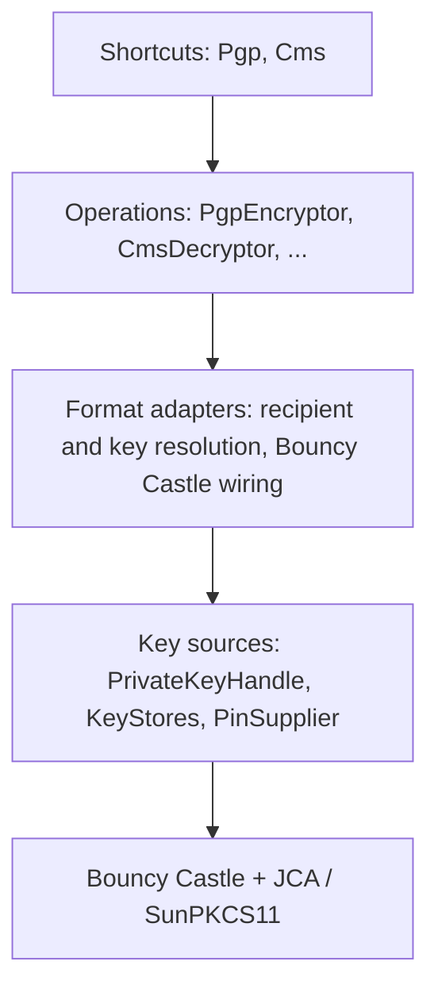

# Design: commons-crypto

## Overview

`commons-crypto` wraps Bouncy Castle behind a small stream API and routes private-key
operations through JCA providers, so a hardware token works like any other key. It is
three modules: a core with the shared key and token code, and one module per format. The
split follows how Bouncy Castle itself ships (`bcprov`, `bcpkix` for CMS, `bcpg` for
OpenPGP), lets the build enforce what a consumer pulls in, and keeps the two formats from
depending on each other.

## Architecture



| Layer | Knows about | Visibility |
| --- | --- | --- |
| Shortcuts | Operations | public |
| Operations | Requests, results, streams | public |
| Format adapters | Bouncy Castle, format packets | package-private |
| Key sources | Tokens, PINs, JCA | public, no format knowledge |
| Engines | Algorithms | third party |

## Modules and packages

| Module | Packages | Depends on |
| --- | --- | --- |
| `commons-crypto` | `com.example.commons.crypto` (PrivateKeyHandle, KeyStores, PinSupplier, SignatureMode, CryptoException and subtypes, shared option types), `...crypto.pkcs11` (token loading, login, provider configuration, ECDH adapter provider) | `bcprov` |
| `commons-crypto-cms` | `com.example.commons.crypto.cms` (CmsEncryptor, CmsDecryptor, CmsSigner, CmsVerifier, Cms) | `commons-crypto`, `bcpkix` |
| `commons-crypto-openpgp` | `com.example.commons.crypto.openpgp` (PgpEncryptor, PgpDecryptor, PgpSigner, PgpVerifier, Pgp) | `commons-crypto`, `bcpg` |

The three modules sit in the `commons-crypto` directory under an aggregator whose artifact is
`commons-crypto-parent` (`commons-crypto/pom.xml`), which
is itself a module of `commons-parent` beside `commons`, `commons-audit`, `commons-accounts`
and `commons-aws`. The aggregator holds the Bouncy Castle version and its dependency
management, so the root `pom.xml` only lists the `commons-crypto` directory and the three module
versions. The shared module is `commons-crypto/commons-crypto`.
Every module is named after the package it owns. The root package exists only in `commons-crypto`, so no package is split across jars.

There is no common `Encryptor` interface across formats. The formats differ in how
recipients are named, how keys are chosen on decrypt and how trust works, so a shared
type would hide real differences. Only the private operation and token access are
shared, and they live in the `commons-crypto` module.

## Key handles

```java
public interface PrivateKeyHandle extends AutoCloseable {
    PrivateKey key();      // may be a non-extractable token object
    Provider provider();   // must perform operations with this key
}

public final class KeyStores {
    static PrivateKeyHandle pkcs11(Path config, PinSupplier pin, String alias);
    static PrivateKeyHandle pkcs12(Path file, char[] password, String alias);
}

public interface PinSupplier { char[] pin(TokenInfo token); }
```

The token handle owns the PKCS#11 login, serialises access that the provider requires,
and is closed by the caller. A wrong PIN throws and is never retried, because a retry
counter on the token could lock it.

## API sketch

The API as built. Streams are never closed by the library.

OpenPGP:

```java
// Encrypt, with every encryption subkey of each recipient; armored output
PgpEncryptor.create().encrypt(
    EncryptRequest.builder()
        .recipients(PgpPublicKeys.fromArmored(recipientAsc))
        .armored(true)
        .build(),
    in, out);

// Decrypt with software keys, or with a key on a token paired with its public keys
PgpDecryptor.create().decrypt(
    DecryptRequest.builder()
        .keys(PgpSecretKeys.token(handle, publicKeys))
        .build(),
    in, out);

// Sign first, then encrypt; the signature is inside the encryption
PgpEncryptor.create().signAndEncrypt(
    SignRequest.builder().signer(signerKeys).build(),
    EncryptRequest.builder().recipients(recipientKeys).build(),
    in, out);

// Decrypting and verifying in one call reports every signature, unknown signers included
VerifyResult r = PgpDecryptor.create().decryptAndVerify(
    DecryptRequest.builder().keys(recipientSecretKeys).build(),
    VerifyRequest.builder().keys(senderPublicKeys).build(),
    in, out);
```

CMS:

```java
CmsEncryptor.create().encrypt(
    EncryptRequest.builder().recipients(CmsRecipient.certificate(cert)).build(),
    in, out);

CmsDecryptor.create().decrypt(
    DecryptRequest.builder().key(handle, ownCert).build(), in, out);

CmsEncryptor.create().signAndEncrypt(signRequest, encryptRequest, in, out);

VerifyResult r = CmsDecryptor.create().decryptAndVerify(decryptRequest, verifyRequest, in, out);
```

Signing and verifying:

```java
// Embedded: the output holds the data and the signature
PgpSigner.create().sign(
    SignRequest.builder().signer(signerKeys).mode(SignatureMode.EMBEDDED).build(), in, out);

// Detached: the output is the signature only; verify against the data
PgpSigner.create().sign(
    SignRequest.builder().signer(signerKeys).mode(SignatureMode.DETACHED).armored(true).build(),
    data, signatureOut);
VerifyResult v = PgpVerifier.create().verifyDetached(
    VerifyRequest.builder().keys(senderPublicKeys).build(), data, signatureIn);

// OpenPGP only: a cleartext signature keeps the text readable
PgpSigner.create().sign(SignRequest.builder().signer(signerKeys).cleartext().build(), text, out);

// CMS takes a key handle and its certificate for each signer
CmsSigner.create().sign(
    SignRequest.builder().signer(handle, cert).mode(SignatureMode.DETACHED).build(), data, signatureOut);
```

Shortcuts for the defaults: `Pgp.encrypt(in, out, recipientKeys)`, `Pgp.sign(in, out, signerKeys)`,
`Pgp.verifyDetached(data, signature, senderKeys)`, `Cms.decrypt(in, out, handle, cert)`, and the
matching `decrypt`, `signDetached` and `verify` forms in both classes.

## Hardware keys

The private operation goes through the key handle's provider: SunPKCS11 for tokens. The
Bouncy Castle JCE operator classes accept a provider, so session-key unwrap and signing
happen on the token.

Constraints:

- OpenPGP RSA key transport is PKCS#1 v1.5, so the token must expose `CKM_RSA_PKCS`.
  Some HSM policies disable it. CMS can use OAEP.
- PGP ECDH and CMS key agreement need a raw agreement on the token with the key
  derivation function in software. Bouncy Castle's PGP ECDH code does the agreement
  itself, so ECC on tokens needs a spike and is deferred.
- The public half of an OpenPGP key is not on the token. The caller supplies it, and the
  handle binding checks it against the token key.

### Spike findings

The spike ran Bouncy Castle 1.80, and was repeated on 1.86 with identical results, against SoftHSM2 2.6.1 through SunPKCS11, in containers
with Temurin 17, 21 and 25. The token key was generated on the token and reported as not
extractable.

| Operation | Result |
| --- | --- |
| CMS sign (SHA256withRSA, detached), token signs, software verifies | Works |
| CMS `AuthEnvelopedData` (AES-256-GCM) with PKCS#1 v1.5 key transport, unwrap on token | Works, with and without `mustProduceEncodableUnwrappedKey` |
| CMS key transport with OAEP, unwrap on token | **Fails.** SunPKCS11 registers only `RSA/ECB/PKCS1Padding` and `RSA/ECB/NoPadding` on all three JDKs, although the token offers `CKM_RSA_PKCS_OAEP` |
| OpenPGP decrypt (PKCS#1 v1.5 session key unwrap on token, MDC verified) | Works through `JcePublicKeyDataDecryptorFactoryBuilder.build(PrivateKey)` |
| OpenPGP sign on token, software verifies | Works only with a workaround, see below |

Consequences:

1. **OAEP on a token is not available through SunPKCS11.** It fails for SHA-1 and SHA-256
   alike, and the JDK 25 `P11RSACipher` class contains only `nopadding` and `pkcs1padding`,
   so the gap is in the JDK, not in the hash choice. Separately, SoftHSM2 2.6.1 supports
   OAEP only with SHA-1 and MGF1-SHA1; other hashes landed in the SoftHSM2 repository in
   June 2026 (commit de25233) and are not in a release the spike used. R8 refuses CMS PKCS#1 v1.5 key
   transport by default, so a CMS token key cannot decrypt under the default policy. The
   options are a vendor JCA provider that supports OAEP, raw RSA on the token with OAEP
   decoding in software (a decode attempt in the spike was inconclusive and needs a
   re-test), a direct PKCS#11 binding, or allowing v1.5 for token keys only. This is an
   open decision.
2. **SunPKCS11 lists a private key only if the token also holds a certificate for it.**
   A key pair generated on a token without a certificate does not appear in the
   `KeyStore`. OpenPGP keys have no X.509 certificate, so a PGP-only token needs a
   placeholder certificate written to it (the spike used one signed by a throwaway key),
   or a lookup that bypasses the key store.
3. **`JcaPGPKeyConverter.getPGPPrivateKey(pub, privateKey)` fails** with a
   `ClassCastException` on a token key because it expects `RSAPrivateCrtKey`. The
   workaround that worked is a `PGPPrivateKey` with dummy secret material plus a
   `PGPContentSignerBuilder` that calls `JcaPGPContentSignerBuilder.build(type, keyId,
   privateKey)` with the token key.

### ECC spike findings

The same setup, with a P-256 key generated on the token, on JDK 17 and 25.

| Operation | Result |
| --- | --- |
| CMS sign with ECDSA-SHA256, token signs, software verifies | Works |
| OpenPGP ECDSA sign on token, software verifies | Works with the same custom signer builder as RSA |
| Raw ECDH on the token through `KeyAgreement` | Works only after configuring the provider so derived secret keys are `CKA_SENSITIVE=false` and `CKA_EXTRACTABLE=true`; the default fails with `CKR_ATTRIBUTE_SENSITIVE`. Only the shared secret leaves the token, never the private key |
| CMS key agreement (ECDH) decrypt with Bouncy Castle 1.80 and 1.86 | **Fails, in layers.** The recipient needs `setPrivateKeyAlgorithmIdentifier` because the token key has no encoding. Then it needs a provider that offers a key factory by OID, and finally a key agreement with the key derivation built in (`ECDHwithSHA256KDF`), which only the Bouncy Castle provider has. SunPKCS11 offers plain `ECDH` only |
| OpenPGP ECDH decrypt with Bouncy Castle 1.80 and 1.86 | **Fails, in layers.** `JcaPGPPrivateKey` is the supported carrier for a token key and gets past the "requires PGPPrivateKey" check. Then Bouncy Castle asks for a key agreement named by `RFC6637Utils.getAgreementAlgorithm` (key derivation built in), which SunPKCS11 does not provide |
| Ed25519 and X25519 through SunPKCS11 | **Not available.** The provider has no EdDSA or XDH services on JDK 17 or 25, although SoftHSM2 generated an Ed25519 key |

Consequences:

1. ECC on a token does not escape the problem. Signing works for RSA and P-256, and the
   PGP signing workaround is unnecessary: `JcaPGPPrivateKey` passed to
   `PGPSignatureGenerator.init` works directly. Bouncy Castle expects the key agreement
   and its key derivation in one `KeyAgreement`, so decryption needs a small adapter. The
   most promising one is a thin JCA provider in this library that registers the
   Bouncy Castle algorithm names, does the raw ECDH on the token through SunPKCS11, and
   applies the key derivation in software. Both formats use it unchanged. The spike built
   it (about 90 lines) and it works, see the adapter results below.
2. The provider configuration is part of the contract: ECDH on SunPKCS11 needs the
   derived-secret attributes set, so `KeyStores.pkcs11` should build the provider
   configuration itself instead of taking an arbitrary file.
3. Modern curves (Ed25519, X25519) are out of reach through SunPKCS11 on current JDKs, so
   v1 token support is RSA and the NIST curves.

### ECDH adapter spike

A small provider, `TokenEcdh`, registered ahead of Bouncy Castle:

- It registers the names Bouncy Castle asks for: `ECCDHwithSHA256CKDF` (and 384, 512) for
  OpenPGP, and `ECDHwithSHA*KDF` plus the CMS key agreement OIDs for CMS.
- It accepts only keys that are private, `EC` and non-encodable, so software keys still go
  to Bouncy Castle.
- The raw agreement runs on the token (`KeyAgreement` "ECDH" through the token provider);
  the key derivation runs in software: the concatenation KDF for OpenPGP (RFC 6637) and
  the X9.63 KDF (`KDF2BytesGenerator`) for CMS. For CMS, Bouncy Castle builds the
  `ECC-CMS-SharedInfo` and passes it as the user keying material.
- Results on JDK 17 and 25 with P-256: CMS `AuthEnvelopedData` ECDH decrypt (SHA-1 and SHA-256
  KDF OIDs) and OpenPGP ECDH decrypt both pass, with the private key on the token. The
  CMS derivation matches Bouncy Castle's own provider byte for byte, for AES-128 and
  AES-256 key wrap, with and without user keying material.

Requirements the adapter puts on the surrounding code:

1. The CMS recipient needs `setPrivateKeyAlgorithmIdentifier(id-ecPublicKey, curve)`,
   because a token key has no encoding.
2. The OpenPGP decryptor takes the key as `JcaPGPPrivateKey`, not a bare `PrivateKey`.
3. The token provider configuration must set derived secret keys to non-sensitive and
   extractable, so the library builds that configuration itself.
4. Neither `setProvider` nor `setContentProvider` may force the token provider for the
   recipient; the late-binding lookup selects the adapter by key. Bouncy Castle stays
   registered for the key factory and content cipher.
5. A JCE provider must be acceptable to the JDK in use. OpenJDK builds accept unsigned
   providers; an Oracle JDK build may need this checked.
6. Not covered: curves other than P-256, cofactor-multiplied agreement (`ECDHC`) on curves
   with a cofactor above 1, and X25519 (unavailable through SunPKCS11 anyway).

## Token decrypt policy

| Key on the token | Format | Result |
| --- | --- | --- |
| RSA | OpenPGP | Works (PKCS#1 v1.5 is the only scheme) |
| RSA | CMS, OAEP recipient | Fails with a clear error through SunPKCS11; works with a vendor provider that has OAEP |
| RSA | CMS, PKCS#1 v1.5 recipient | Works only after `allowPkcs1v15KeyTransport()` on that key handle |
| EC P-256 | OpenPGP and CMS | Works through the `TokenEcdh` adapter provider |
| Ed25519, X25519 | any | Not available through SunPKCS11 |

The library registers the adapter and builds the token provider configuration, so the caller
sees only a key handle. The error for an unsupported combination names the key type, the
format and the way out.

### Token keys in the formats

How the formats use a token key, as built:

- **Provider selection.** The key handle carries the token's provider. Signing and RSA
  decryption use it directly. Elliptic curve decryption does not force a provider: the library
  registers the `TokenEcdhProvider` once, when a token is first opened, and Bouncy Castle finds
  its agreements and key factories by name. The adapter keeps a list of the open tokens'
  providers and does the plain ECDH through whichever one accepts the key, so the token
  providers themselves are never added to the JDK's provider list.
- **Key factories.** Bouncy Castle looks up the EC key factory by the OID `1.2.840.10045.2.1`
  (CMS) and by `ECDH` (OpenPGP). The JDK has neither name, so the adapter provider offers both
  and hands them to the JDK's EC key factory.
- **CMS.** For an EC token key the decryptor tells Bouncy Castle the key algorithm (taken from
  the certificate's public key), because the key has no encoding. An RSA OAEP recipient on a
  token key fails with an error that names the missing OAEP; a PKCS#1 v1.5 recipient is accepted
  only after `allowPkcs1v15KeyTransport()` on that key handle.
- **OpenPGP.** `PgpSecretKeys.token(handle, publicKeys)` pairs the key with the matching public
  key and uses `JcaPGPPrivateKey` as the carrier. The key flags of the public key decide whether
  it can sign. Bouncy Castle's builder resets its content provider when a provider is set, so
  the content provider is set after it.
- **Test token.** The container script puts an RSA key (alias `k`) and an EC P-256 key (alias
  `ec`) on the token. The EC key must be imported with the sign and derive usages.

### Token keys without a certificate

SunPKCS11 lists a private key only if the token also holds a certificate for it, so a key pair
that was generated on a token without one (an OpenPGP-only key, for example) is not visible to
the library, and a Java helper cannot add the certificate because it cannot address the key.
Give the key a placeholder certificate with the same public key and the same `CKA_ID`. Nothing
checks the certificate's signature, so any signer will do. With OpenSC's `pkcs11-tool` and
OpenSSL, for a key with ID `01`:

```bash
pkcs11-tool --module "$MODULE" --login --read-object --type pubkey --id 01 -o public.der
# Build cert.der around public.der, signed by any throwaway key, then store it:
pkcs11-tool --module "$MODULE" --login --write-object cert.der --type cert --id 01 --label alias
```

The container script in the test directory stores a certificate next to each key it imports.

## Streaming and integrity

All operations stream. Signatures and integrity tags come at the end of the data, so a
decrypt can write plaintext before it knows the message is intact. The contract is that
on failure the call throws after the stream ends, and the caller discards what was
written. The library does not buffer to a file. Unauthenticated formats are refused
unless legacy compatibility is set, which removes the largest tampering risk.

## Algorithm policy

Defaults are AES-256 in an authenticated mode. 3DES, CAST5, SHA-1 signatures and CMS
PKCS#1 v1.5 key transport are refused. Legacy compatibility relaxes this for reading
only: decrypt and verify accept old algorithms, while encrypt and sign still refuse
them.

## Errors

```
CryptoException (unchecked)
  NoMatchingKeyException
  IntegrityException
  TokenUnavailableException
  PinRequiredException
```

## Testing

- Unit tests use software keys and run in `mvn test`.
- A profile runs SoftHSM2 in a container for PKCS#11 and GnuPG and OpenSSL for
  interoperability in both directions, for every signature mode.
- The interoperability tests run `gpg` and `openssl` and are skipped unless `INTEROP_TOOLS` is
  `true`, which the container script sets. They use the test keys of each module and cover both
  directions: our output read by the tool and the tool's output read by us. OpenPGP against GnuPG:
  encryption, and embedded, detached and cleartext signatures, binary and armored, for RSA and EC
  keys, plus sign-and-encrypt. CMS against OpenSSL: embedded and detached signatures in DER and
  PEM for RSA and EC keys, encryption in both directions.
- The PKCS#11 tests need a native module in the JVM's process, so they run inside a container
  that holds both the JVM and the token. They skip themselves unless `PKCS11_LIBRARY` is set.
  `commons-crypto/commons-crypto/src/test/docker/pkcs11/` has the Dockerfile and
  `run-tests.sh`, which sets up a token with an RSA key under the alias `k`, an EC key under the
  alias `ec` and the PIN `1234`, builds all three modules in a copy of the repository, and then
  runs the tests that use a token a second time against an NSS software token (see below):

  ```bash
  docker build -t commons-crypto-pkcs11-test commons-crypto/commons-crypto/src/test/docker/pkcs11
  docker run --rm -v "$PWD:/repo:ro" -v "$HOME/.m2:/root/.m2" commons-crypto-pkcs11-test     sh /repo/commons-crypto/commons-crypto/src/test/docker/pkcs11/run-tests.sh
  ```
- Each format module's tests run with only its own Bouncy Castle artifacts on the
  classpath, which the module dependencies enforce without a separate variant.

### A second token implementation

SoftHSM2 is one implementation, so the tests that use a token also run against NSS's software token
(`libsoftokn3`, from the `libnss3-tools` package), which SunPKCS11 supports. The test keys of the
CMS module are imported into an NSS database with `pk12util`, which gives the aliases `rsa` and `ec`.
The token tests read which token to use from the environment: `PKCS11_LIBRARY`, and optionally
`PKCS11_SLOT_LIST_INDEX`, `PKCS11_EXTRA_SETTINGS`, `PKCS11_PIN`, `PKCS11_RSA_ALIAS` and
`PKCS11_EC_ALIAS`.

- NSS needs one setting the library does not make itself, so `Pkcs11Config.Builder.extraSettings`
  adds module-specific lines to the SunPKCS11 configuration: `nssArgs="configdir='sql:/db' certPrefix=''
  keyPrefix='' secmod='secmod.db' flags=readWrite"`. Its keys are in the second slot
  (`slotListIndex=1`).
- All token tests pass on both tokens: login and PIN handling, signing and key agreement with RSA and EC
  keys in both formats, the OAEP error, and the PKCS#1 v1.5 opt-in.
- It found one real difference. OpenPGP signing asked the token's provider for the SHA-256 or SHA-512
  digest as well as the signature. SoftHSM2's provider offers digests, NSS's does not. The digest is now
  always computed by Bouncy Castle and only the signature is made on the token.
- Still untested: any real hardware token, and tokens whose provider differs more, such as a vendor
  HSM provider.

### Interoperability results

Run in the container image (Ubuntu 24.04: GnuPG 2.4.4, OpenSSL 3.0.13):

- **GnuPG** verifies and decrypts everything we write, and we read everything GnuPG writes
  (encrypt, sign, detach-sign, clearsign, and sign-and-encrypt), for RSA and P-256 keys. GnuPG
  compresses what it writes and the decryptor and verifier handle that.
- **OpenSSL** verifies our embedded and detached signatures (DER and PEM, RSA and EC). It also
  decrypts our `AuthEnvelopedData` messages (AES-256-GCM with RSA OAEP, and with ECDH), so
  the default CMS output is readable by OpenSSL 3.0 and newer.
- OpenSSL's own encryption is `EnvelopedData` with AES-CBC, which is not authenticated, so we
  refuse it unless legacy compatibility is set. With it set, we read RSA PKCS#1 v1.5, RSA OAEP and
  ECDH recipients from OpenSSL.
- When GnuPG signs for a key whose self-signature has no preferred hash algorithms it falls back
  to SHA-1, which we refuse by default. Real keys carry preferences; the test keys now do too.

### Hardening

A review of the security-sensitive code led to these, each with a test:

- **Providers.** One shared Bouncy Castle provider lives in the core module
  (`BouncyCastle.provider()`) instead of one per format module. A key handle that is not a
  `Pkcs11PrivateKeyHandle` has its own provider used for EC key agreement too, where before the
  decryptors assumed SunPKCS11. This is covered with a stub provider around Bouncy Castle, not with
  a vendor provider, so it shows the branch is taken and gives the right result, not that a
  particular vendor's provider accepts Bouncy Castle's algorithm names.
- **Limits.** Compression nesting is capped at 4, `maxOutputBytes` is available on decrypt and
  verify requests, and armored CMS lines are capped at 1024 bytes.
- **Keys.** `PgpSecretKeys` is `AutoCloseable` and refuses use after closing.
- **Known and accepted.** Verification does not look at revocation or expiry of the signing key, in
  line with the library leaving trust to the caller; the documentation says so. The CMS decryptor
  tries only the first recipient entry that matches the key.

## Open risks

1. `CKM_RSA_PKCS` availability on the target HSMs for OpenPGP.
2. Bouncy Castle moves quickly (1.86 at the time of writing); the spike should be rerun on upgrades.
3. The ECDH adapter is only proven on P-256 with SoftHSM2; other curves and real HSMs are untested.
4. The adapter is a JCE provider; its acceptance on non-OpenJDK builds is unchecked.
