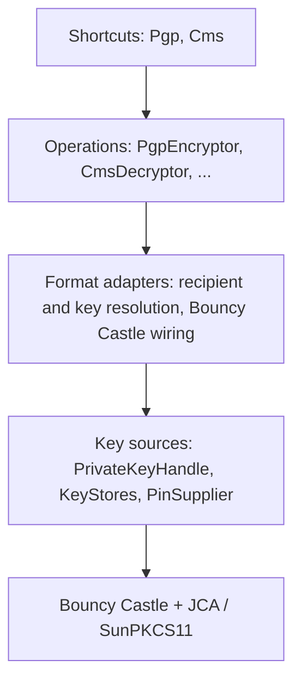

# Design: io-crypto

## Overview

`io-crypto` wraps Bouncy Castle behind a small stream API and routes private-key
operations through JCA providers, so a hardware token works like any other key. It is
one artifact with a shared root package and two format packages, because that keeps the
build simple and the optional Bouncy Castle dependencies let a consumer pay only for the
format it uses. If the optional-dependency contract proves fragile, the package layout
lets it split into modules without moving code.

## Architecture



| Layer | Knows about | Visibility |
| --- | --- | --- |
| Shortcuts | Operations | public |
| Operations | Requests, results, streams | public |
| Format adapters | Bouncy Castle, format packets | package-private |
| Key sources | Tokens, PINs, JCA | public, no format knowledge |
| Engines | Algorithms | third party |

## Packages

```
com.example.io.crypto            PrivateKeyHandle, KeyStores, PinSupplier, SignatureMode,
                                 CryptoException and subtypes, shared option types
com.example.io.crypto.pkcs11     token loading, login, session lifecycle
com.example.io.crypto.openpgp    PgpEncryptor, PgpDecryptor, PgpSigner, PgpVerifier, Pgp
com.example.io.crypto.cms        CmsEncryptor, CmsDecryptor, CmsSigner, CmsVerifier, Cms
```

There is no common `Encryptor` interface across formats. The formats differ in how
recipients are named, how keys are chosen on decrypt and how trust works, so a shared
type would hide real differences. Only the private operation and token access are
shared, and they live in the root package.

## Key handles

```java
public interface PrivateKeyHandle extends AutoCloseable {
    PrivateKey key();      // may be a non-extractable token object
    Provider provider();   // must perform operations with this key
}

public final class KeyStores {
    static PrivateKeyHandle pkcs11(Path config, PinSupplier pin, String alias);
    static PrivateKeyHandle pkcs12(Path file, char[] password, String alias);
}

public interface PinSupplier { char[] pin(TokenInfo token); }
```

The token handle owns the PKCS#11 login, serialises access that the provider requires,
and is closed by the caller. A wrong PIN throws and is never retried, because a retry
counter on the token could lock it.

## API sketch

OpenPGP:

```java
PgpEncryptor.create().encrypt(
    EncryptRequest.builder()
        .recipients(PgpPublicKeys.fromArmored(recipientAsc))
        .signWith(signerKey)               // optional, sign then encrypt
        .armored(true)
        .build(),
    in, out);

DecryptResult r = PgpDecryptor.create().decrypt(
    DecryptRequest.builder()
        .keys(PgpSecretKeys.token(handle, publicCert))
        .verifyWith(senderPublicKeys)      // optional
        .build(),
    in, out);
r.signatures();   // signer, valid or not, signing time, unknown signers included
```

CMS:

```java
CmsEncryptor.create().encrypt(
    EncryptRequest.builder()
        .recipients(CmsRecipient.certificate(cert))
        .build(),
    in, out);

CmsDecryptor.create().decrypt(
    DecryptRequest.builder().key(handle, ownCert).build(), in, out);
```

Signing:

```java
PgpSigner.create().sign(
    SignRequest.builder().signer(handle, publicCert)
        .mode(SignatureMode.DETACHED).armored(true).build(),
    data, signatureOut);

VerifyResult v = PgpVerifier.create().verify(
    VerifyRequest.builder().keys(senderPublicKeys).build(),
    data, signatureIn);
```

Shortcuts: `Pgp.encrypt(in, out, recipientAsc)`, `Cms.decrypt(in, out, handle, cert)`.
`CLEARTEXT` is a method on the PGP `SignRequest` builder only.

## Hardware keys

The private operation goes through the key handle's provider: SunPKCS11 for tokens. The
Bouncy Castle JCE operator classes accept a provider, so session-key unwrap and signing
happen on the token.

Constraints:

- OpenPGP RSA key transport is PKCS#1 v1.5, so the token must expose `CKM_RSA_PKCS`.
  Some HSM policies disable it. CMS can use OAEP.
- PGP ECDH and CMS key agreement need a raw agreement on the token with the key
  derivation function in software. Bouncy Castle's PGP ECDH code does the agreement
  itself, so ECC on tokens needs a spike and is deferred.
- The public half of an OpenPGP key is not on the token. The caller supplies it, and the
  handle binding checks it against the token key.

## Streaming and integrity

All operations stream. Signatures and integrity tags come at the end of the data, so a
decrypt can write plaintext before it knows the message is intact. The contract is that
on failure the call throws after the stream ends, and the caller discards what was
written. The library does not buffer to a file. Unauthenticated formats are refused
unless legacy compatibility is set, which removes the largest tampering risk.

## Algorithm policy

Defaults are AES-256 in an authenticated mode. 3DES, CAST5, SHA-1 signatures and CMS
PKCS#1 v1.5 key transport are refused. Legacy compatibility relaxes this for reading
only: decrypt and verify accept old algorithms, while encrypt and sign still refuse
them.

## Errors

```
CryptoException (unchecked)
  NoMatchingKeyException
  IntegrityException
  TokenUnavailableException
  PinRequiredException
```

## Testing

- Unit tests use software keys and run in `mvn test`.
- A profile runs SoftHSM2 in a container for PKCS#11 and GnuPG and OpenSSL for
  interoperability in both directions, for every signature mode.
- Two build variants prove the optional dependencies: CMS tests without `bcpg` and
  OpenPGP tests without `bcpkix`.

## Open risks

1. ECC on tokens (deferred spike).
2. `CKM_RSA_PKCS` availability on the target HSMs for OpenPGP.
3. The optional-dependency contract in one artifact.
